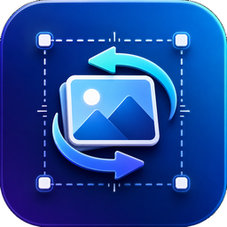
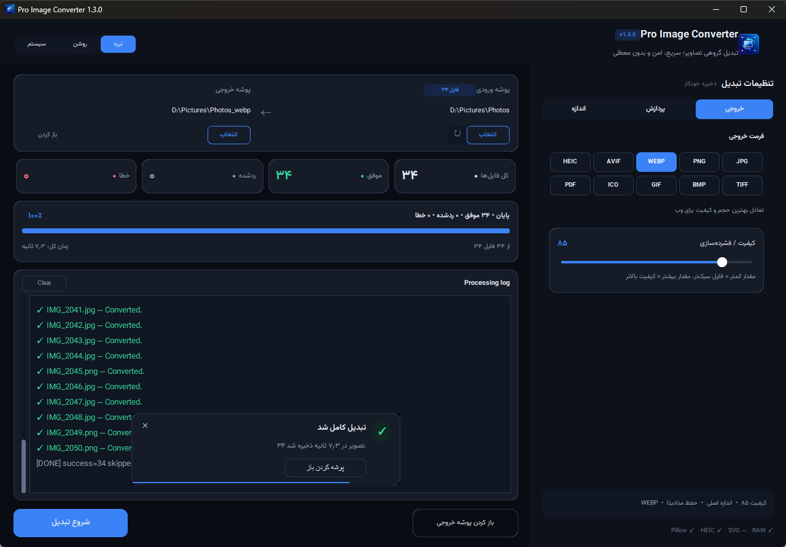
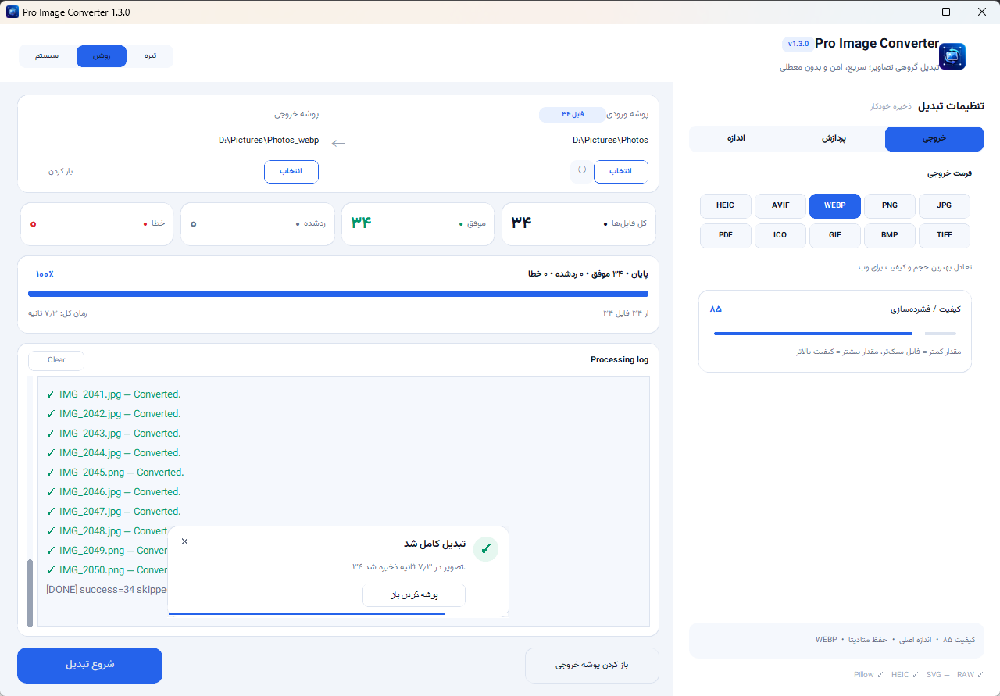
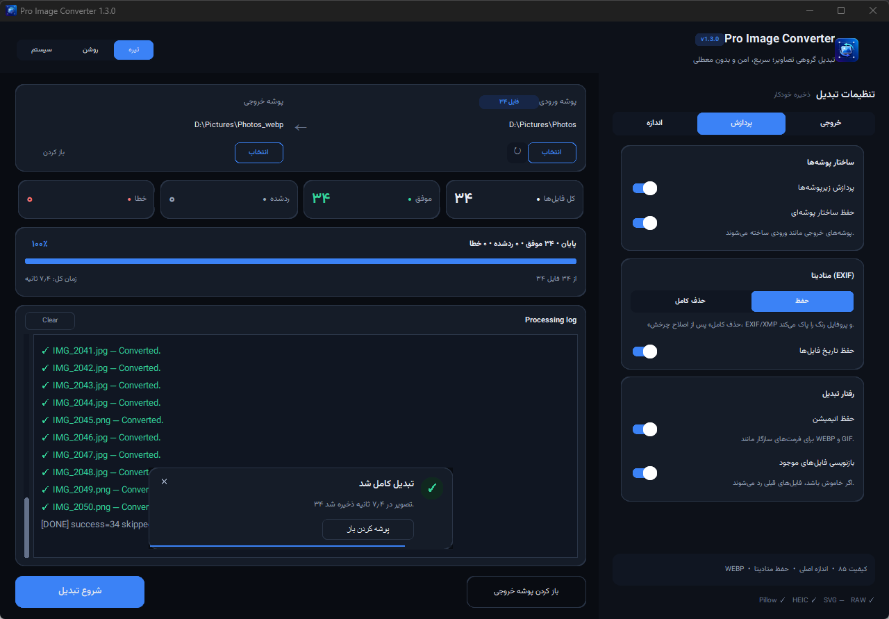
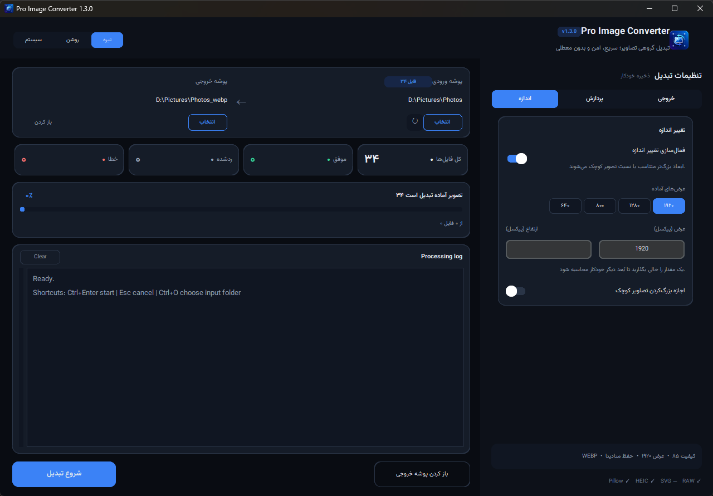

<p align="center">
  
</p>

<h1 align="center">Pro Image Converter</h1>

<p align="center">
  <b>Batch-convert whole folders of images — fast, safe, and without freezing.</b><br>
  مبدل حرفه‌ای و دسته‌ای تصاویر برای ویندوز
</p>

<p align="center">
  <a href="https://github.com/mr-shady/ProImageConverter/releases/latest/download/ProImageConverter.exe"></a>
  <a href="https://mr-shady.github.io/ProImageConverter/"></a>
</p>

<p align="center">
  
  
  
  
</p>

<p align="center">
  <a href="#-features">Features</a> •
  <a href="#-formats">Formats</a> •
  <a href="#-download">Download</a> •
  <a href="#%EF%B8%8F-run-from-source">Run from source</a> •
  <a href="#-راهنمای-فارسی">راهنمای فارسی</a>
</p>

<p align="center">
  
</p>

> **Try it in your browser:** the [website](https://mr-shady.github.io/ProImageConverter/#playground) has a small live converter (WEBP / JPG / PNG) that runs entirely on your machine — nothing is uploaded.

---

## ✨ Features

- **Batch processing** — convert a whole folder (thousands of files) using multiple worker threads; the UI stays responsive and you can cancel at any time.
- **Subfolders & structure** — optionally scan subfolders and recreate the same folder tree in the output.
- **Quality & resize** — set compression quality, pick a preset width (1920 / 1280 / 800 / 640) or custom dimensions; aspect ratio is always kept, upscaling is opt-in.
- **Metadata** — keep EXIF, ICC colour profiles and file timestamps, or strip all metadata for privacy.
- **Transparency & animation** — choose a background colour for formats without alpha (JPG / BMP / PDF); animated GIF and WEBP stay animated.
- **Safe writes** — every file is written to a temp file first and then moved into place, so nothing is left half-written; existing files are only overwritten if you allow it.
- **Modern RTL UI** — dark, light and system themes, floating toasts instead of blocking dialogs, live progress with speed and ETA, auto-saved settings.
- **Keyboard shortcuts** — `Ctrl+Enter` start · `Esc` cancel · `Ctrl+O` input folder · `Ctrl+Shift+O` output folder · `Ctrl+L` clear log.

## 🖼 Screenshots

| Output tab (dark) | Light theme |
| :---: | :---: |
|  |  |
| **Processing tab** | **Size tab** |
|  |  |

## 🗂 Formats

| | Formats |
| --- | --- |
| **Output** | WEBP, JPG, PNG, AVIF, HEIC, TIFF, BMP, GIF, ICO, PDF |
| **Input** | JPG, PNG, WEBP, HEIC, AVIF, TIFF, BMP, GIF, … |
| **Optional input** | SVG (via CairoSVG) · RAW camera files — DNG, CR2, CR3, NEF, ARW, RAF, ORF, RW2 and more (via rawpy) |

The app detects at runtime which formats your installed libraries can read and write, and only offers those. SVG is input-only: turning pixels into a real vector file is vectorisation, not format conversion.

## 📥 Download

Grab the standalone executable — no Python needed:

**[⬇ ProImageConverter.exe — v1.3.0, Windows 10/11 x64 (~42 MB)](https://github.com/mr-shady/ProImageConverter/releases/latest/download/ProImageConverter.exe)**

If Windows SmartScreen warns you, click **More info → Run anyway**.

## ⚙️ Run from source

Requires **Python 3.11+** (tick *Add Python to PATH* when installing).

**Quick way (Windows):** run `install.bat`, then `run.bat`.

**Manual:**

```bash
git clone https://github.com/mr-shady/ProImageConverter.git
cd ProImageConverter
python -m pip install -r requirements.txt
python app.py
```

**Optional SVG & RAW support:**

```bash
python -m pip install -r requirements-optional.txt
```

**Build the .exe** (output goes to `dist/`):

```bash
build_exe.bat
```

**Engine self-test** (no GUI):

```bash
python smoke_test.py
```

---

## 🇮🇷 راهنمای فارسی

**Pro Image Converter** یک برنامه‌ی دسکتاپ ویندوز برای تبدیل دسته‌ای و سریع تصاویر است که با پایتون و CustomTkinter ساخته شده است.

- **وب‌سایت:** [mr-shady.github.io/ProImageConverter](https://mr-shady.github.io/ProImageConverter/) (با امکان امتحان آنلاین داخل مرورگر)
- **دانلود:** [ProImageConverter.exe نسخه‌ی 1.3.0، ویندوز ۶۴ بیتی](https://github.com/mr-shady/ProImageConverter/releases/latest/download/ProImageConverter.exe) — بدون نیاز به نصب پایتون

### قابلیت‌های کلیدی

- **تبدیل گروهی:** پردازش هزاران تصویر یک پوشه با چند رشته‌ی هم‌زمان، بدون قفل‌شدن برنامه و با امکان لغو.
- **زیرپوشه‌ها:** پردازش اختیاری زیرپوشه‌ها و ساخت خروجی با همان ساختار.
- **فرمت‌ها:** خروجی WEBP، JPG، PNG، AVIF، HEIC، TIFF، BMP، GIF، ICO و PDF؛ ورودی اختیاری SVG و فایل‌های RAW دوربین.
- **کیفیت و اندازه:** کیفیت قابل تنظیم و تغییر اندازه با حفظ نسبت تصویر.
- **متادیتا:** حفظ EXIF، پروفایل رنگ و تاریخ فایل یا حذف کامل آن‌ها.
- **شفافیت و انیمیشن:** رنگ پس‌زمینه‌ی دلخواه برای JPG/BMP/PDF و حفظ انیمیشن GIF/WEBP.
- **رابط کاربری مدرن:** تم تیره، روشن و سیستم، اعلان‌های شناور و ذخیره‌ی خودکار تنظیمات.

### اجرا از سورس

1. پایتون ۳.۱۱ یا جدیدتر را نصب کنید (گزینه‌ی `Add Python to PATH` فراموش نشود).
2. فایل `install.bat` را اجرا کنید.
3. سپس `run.bat` را اجرا کنید.

راهنمای کامل فارسی، تغییرات نسخه‌ی ۱.۳ و رفع خطاهای رایج در [README_FA.md](README_FA.md) است.

---

## 📄 License

Released under the [MIT License](LICENSE).

<p align="center">Designed &amp; developed by <a href="https://reza-nemati.ir">Reza Nemati</a></p>
