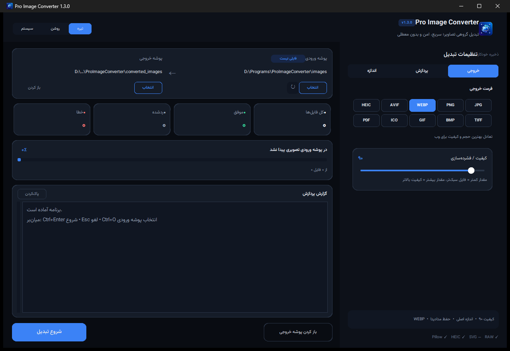
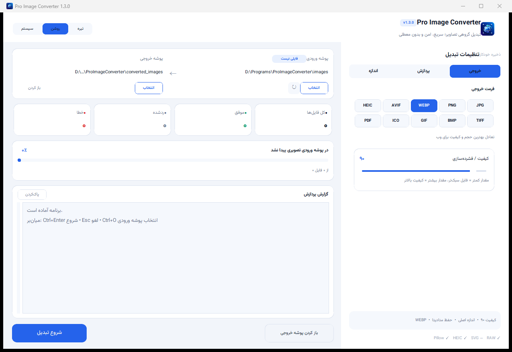

# مبدل حرفه‌ای تصاویر — Pro Image Converter

یک برنامه دسکتاپ فارسی برای تبدیل گروهی تصاویر یک پوشه به فرمت دلخواه.

## نمای برنامه

| حالت تیره | حالت روشن |
| --- | --- |
|  |  |

## امکانات

- انتخاب پوشه ورودی و خروجی
- تبدیل گروهی تمام تصاویر پوشه
- پردازش اختیاری زیرپوشه‌ها
- حفظ ساختار پوشه‌ها
- خروجی JPG، PNG، WEBP، TIFF، BMP، GIF، ICO و PDF
- پشتیبانی AVIF و HEIC در صورت پشتیبانی کتابخانه نصب‌شده
- پشتیبانی ورودی SVG با CairoSVG
- پشتیبانی فایل‌های دوربین RAW با rawpy
- کیفیت قابل تنظیم
- تغییر اندازه با حفظ نسبت تصویر
- حفظ EXIF، پروفایل رنگ و زمان فایل
- مدیریت شفافیت برای JPG/BMP/PDF
- حفظ انیمیشن GIF/WEBP در خروجی‌های سازگار
- نوار پیشرفت، لغو عملیات و گزارش خطا
- اعلان داخلی شناور که خودکار بسته می‌شود (بدون کلیک اضافه)
- رابط کاربری تیره، روشن و هماهنگ با سیستم

## نصب سریع در ویندوز

1. Python 3.11 یا جدیدتر را نصب کنید و گزینه `Add Python to PATH` را فعال کنید.
2. فایل `install.bat` را اجرا کنید.
3. سپس `run.bat` را اجرا کنید.

یا در ترمینال:

```bash
python -m pip install -r requirements.txt
python app.py
```

## پشتیبانی SVG و RAW

این قابلیت‌ها اختیاری‌اند:

```bash
python -m pip install -r requirements-optional.txt
```

- `CairoSVG` برای بازکردن SVG استفاده می‌شود.
- `rawpy` برای DNG، CR2، CR3، NEF، ARW، RAF و دیگر فرمت‌های RAW استفاده می‌شود.
- خروجی SVG ارائه نمی‌شود؛ چون تبدیل تصویر پیکسلی به فایل برداری واقعی نیازمند «وکتورسازی» است و تبدیل عادی فرمت محسوب نمی‌شود.

## ساخت فایل EXE

ابتدا وابستگی‌ها را نصب کنید و سپس:

```bash
build_exe.bat
```

فایل اجرایی در پوشه `dist` ساخته می‌شود.

## نکات مهم

- «هر فرمت به هر فرمت» به‌صورت مطلق در دنیای تصویر ممکن نیست. برنامه فرمت‌های نصب‌شده و قابل رمزگشایی/رمزگذاری را هنگام اجرا تشخیص می‌دهد.
- برای خروجی JPG، BMP و PDF، شفافیت با رنگ انتخاب‌شده در رابط کاربری جایگزین می‌شود.
- اگر خروجی داخل پوشه ورودی باشد، برنامه پوشه خروجی را از اسکن مجدد حذف می‌کند.
- برای جلوگیری از خراب‌شدن فایل، ابتدا خروجی موقت ساخته و سپس به نام نهایی منتقل می‌شود.


## آزمایش موتور تبدیل

بدون بازکردن رابط گرافیکی می‌توانید تست داخلی را اجرا کنید:

```bash
python smoke_test.py
```


## خطای `'py' is not recognized`

در نسخه جدید، فایل‌های BAT ابتدا به‌ترتیب دنبال `py`، `python` و `python3` می‌گردند و مسیرهای معمول نصب پایتون را نیز بررسی می‌کنند.

اگر همچنان پیام «Python was not found» نمایش داده شد:

1. Python 3.11 یا جدیدتر را نصب کنید.
2. هنگام نصب گزینه `Add python.exe to PATH` را فعال کنید.
3. پنجره Command Prompt و پوشه برنامه را ببندید و دوباره باز کنید.
4. ابتدا `install.bat` و سپس `run.bat` را اجرا کنید.

برای بررسی دستی، در Command Prompt یکی از این فرمان‌ها را وارد کنید:

```bat
python --version
py --version
python3 --version
```


## اصلاح مشکل Python داخلی Hermes

اگر مسیر Python به شکل زیر باشد:

```text
C:\Users\...\AppData\Local\hermes\hermes-agent\venv\...
```

این Python متعلق به یک برنامه دیگر است و نباید برای این پروژه استفاده شود. فایل‌های BAT نسخه جدید آن را نادیده می‌گیرند و فقط Python معمولی ویندوز را انتخاب می‌کنند.

وابستگی‌های اصلی برنامه فقط این‌ها هستند:

- Pillow
- CustomTkinter

پشتیبانی HEIC/HEIF دیگر نصب برنامه را متوقف نمی‌کند و با فایل زیر جداگانه نصب می‌شود:

```text
install_optional_formats.bat
```

ترتیب صحیح اجرا:

1. نصب Python رسمی 64 بیتی نسخه 3.11 یا جدیدتر
2. فعال‌کردن `Add python.exe to PATH`
3. اجرای `install.bat`
4. اجرای `run.bat`
5. در صورت نیاز، اجرای `install_optional_formats.bat`


## فونت رابط کاربری

تمام بخش‌های رابط کاربری از فونت **Vazirmatn** استفاده می‌کنند. برنامه نام‌های `Vazirmatn`، `Vazir Matn` و `Vazir` را بررسی می‌کند و اگر هیچ‌کدام روی ویندوز نصب نباشد، برای جلوگیری از خطا به‌صورت خودکار از Tahoma استفاده می‌کند.

برای بررسی شناسایی فونت:

```bat
python check_font.py
```

فایل فونت همراه پروژه توزیع نشده است؛ بنابراین برای نمایش دقیق Vazirmatn باید آن را روی ویندوز نصب کرده باشید و سپس برنامه را دوباره اجرا کنید.


## تغییر اندازه نسبی هوشمند

در نسخه 1.1 سه حالت به‌صورت خودکار پشتیبانی می‌شود:

- فقط عرض را وارد کنید: ارتفاع متناسب با تصویر اصلی محاسبه می‌شود.
- فقط ارتفاع را وارد کنید: عرض متناسب با تصویر اصلی محاسبه می‌شود.
- عرض و ارتفاع را وارد کنید: تصویر با حفظ نسبت داخل کادر تعیین‌شده قرار می‌گیرد.

برای نمونه، تصویر 1200×800 با عرض 900 و ارتفاع خالی، به 900×600 تبدیل می‌شود.

## اعمال کامل Vazirmatn

علاوه بر برچسب‌ها، فونت Vazirmatn اکنون روی دکمه‌ها، ورودی‌ها، منوی انتخاب فرمت، منوی حالت ظاهری، متن گزارش و فونت‌های پیش‌فرض Tk اعمال می‌شود.

## امکانات جدید نسخه 1.2

### حذف کامل متادیتای توصیفی

با فعال‌کردن گزینه «حذف کامل متادیتا»، اطلاعات متداول داخل فایل خروجی پاک می‌شود، از جمله:

- EXIF
- XMP
- IPTC و توضیحات متنی قابل انتقال
- پروفایل رنگ ICC
- Comment، Software، Author، Prompt و داده‌های مشابهی که توسط فرمت و کتابخانه قابل خواندن باشند

برنامه ابتدا چرخش ثبت‌شده در EXIF را روی خود تصویر اعمال می‌کند و سپس متادیتا را حذف می‌کند؛ بنابراین جهت عکس به‌هم نمی‌ریزد. زمان‌بندی و حلقه انیمیشن GIF/WebP برای سالم ماندن انیمیشن حفظ می‌شود.

این قابلیت متادیتای جاسازی‌شده در فایل را پاک می‌کند، اما تضمین نمی‌کند منشأ تصویر از روی محتوای بصری، واترمارک آشکار یا نامرئی، سامانه‌های بیرونی یا روش‌های تشخیص دیگر قابل حدس نباشد.

### ذخیره دائمی تنظیمات

تنظیمات کاربر پس از هر تغییر به‌صورت خودکار ذخیره می‌شود و پس از بستن برنامه، ری‌استارت ویندوز یا اجرای نسخه EXE دوباره بارگذاری خواهد شد. موارد ذخیره‌شده شامل این گزینه‌هاست:

- عرض و ارتفاع و فعال‌بودن تغییر اندازه
- اجازه بزرگ‌کردن تصاویر کوچک
- فرمت خروجی و کیفیت
- حذف یا حفظ متادیتا
- پردازش و حفظ ساختار زیرپوشه‌ها
- حفظ تاریخ فایل و انیمیشن
- رنگ پس‌زمینه شفافیت
- حالت روشن، تیره یا سیستم
- پوشه ورودی و خروجی

در ویندوز، فایل تنظیمات در مسیر زیر ذخیره می‌شود:

```text
%APPDATA%\ProImageConverter\settings.json
```

### آیکن برنامه و فایل EXE

آیکن اختصاصی در پوشه `assets` قرار دارد و در این بخش‌ها استفاده می‌شود:

- پنجره برنامه
- نوار وظیفه ویندوز
- فایل EXE ساخته‌شده با PyInstaller
- میان‌برهای جدید منوی Start و دسکتاپ

برای ساخت EXE دارای آیکن، فایل زیر را اجرا کنید:

```text
build_exe.bat
```

اگر ویندوز آیکن میان‌بر قدیمی را از حافظه کش نشان داد، میان‌بر یا پین قبلی را حذف کنید و فایل EXE جدید را دوباره به Start یا Taskbar اضافه کنید.

### چیدمان سوییچ‌ها

تمام سوییچ‌های تنظیمات اکنون قبل از عنوان فارسی نمایش داده می‌شوند تا ظاهر گزینه‌ها یکدست‌تر باشد.


## امکانات جدید نسخه 1.3 — بازطراحی رابط کاربری و سرعت

این نسخه روی سرعت و راحتی کار روزمره تمرکز دارد:

- **بدون آلرت مزاحم:** پس از پایان تبدیل، به‌جای پنجره پیام که باید «OK» آن را بزنید، یک اعلان شناور داخل برنامه نمایش داده می‌شود و بعد از چند ثانیه خودش بسته می‌شود. دکمه «باز کردن پوشه» هم داخل همان اعلان قرار دارد.
- **شمارش فایل‌ها در پس‌زمینه:** با انتخاب پوشه، تعداد فایل‌ها بدون قفل‌شدن پنجره و بدون دکمه اضافی محاسبه می‌شود. اسکن پوشه‌های بزرگ حدود ۲۰ برابر سریع‌تر شده است.
- **رابط کاربری روان‌تر:** گزارش و آمار در بسته‌های کوچک به‌روزرسانی می‌شوند، بنابراین هنگام تبدیل هزاران فایل، پنجره پاسخ‌گو می‌ماند. زمان سپری‌شده، سرعت و زمان تقریبی باقی‌مانده نمایش داده می‌شود.
- **تب‌بندی تنظیمات:** پنل تنظیمات به سه تب «خروجی»، «پردازش» و «اندازه» تقسیم شده تا گزینه‌ها بدون اسکرول طولانی در دسترس باشند. در پنجره‌های کوچک، خود تب اسکرول می‌شود.
- **انتخاب سریع فرمت:** فرمت خروجی با دکمه‌های تک‌کلیکی و توضیح کوتاه هر فرمت انتخاب می‌شود.
- **چیدمان راست‌به‌چپ:** تنظیمات در سمت راست و کارگاه تبدیل در سمت چپ قرار گرفته است. مسیرها، آمار، پیشرفت و اقدام‌ها بازطراحی و مرتب شده‌اند.
- **حالت متادیتا ساده‌تر:** به‌جای دو سوییچ متضاد، یک انتخاب دو‌حالته «حفظ» یا «حذف کامل» دارد.
- **پالت رنگی هماهنگ:** هر دو حالت تیره و روشن، رنگ‌های کارت، حاشیه، متن و لهجه آبی هماهنگ با آیکن برنامه دارند.
- **میان‌برها:** `Ctrl+Enter` شروع، `Esc` لغو، `Ctrl+O` انتخاب پوشه ورودی، `Ctrl+Shift+O` انتخاب پوشه خروجی و `Ctrl+L` پاک‌کردن گزارش.
- **یادآوری وضعیت پنجره:** اندازه و مکان پنجره و آخرین تب تنظیمات ذخیره و در اجرای بعدی بازیابی می‌شوند. پنجره به‌طور خودکار با اندازه نمایشگر تنظیم می‌شود.

گزارش کامل هر فایل همچنان در بخش «گزارش پردازش» باقی می‌ماند و خطاها با رنگ قرمز مشخص می‌شوند.
